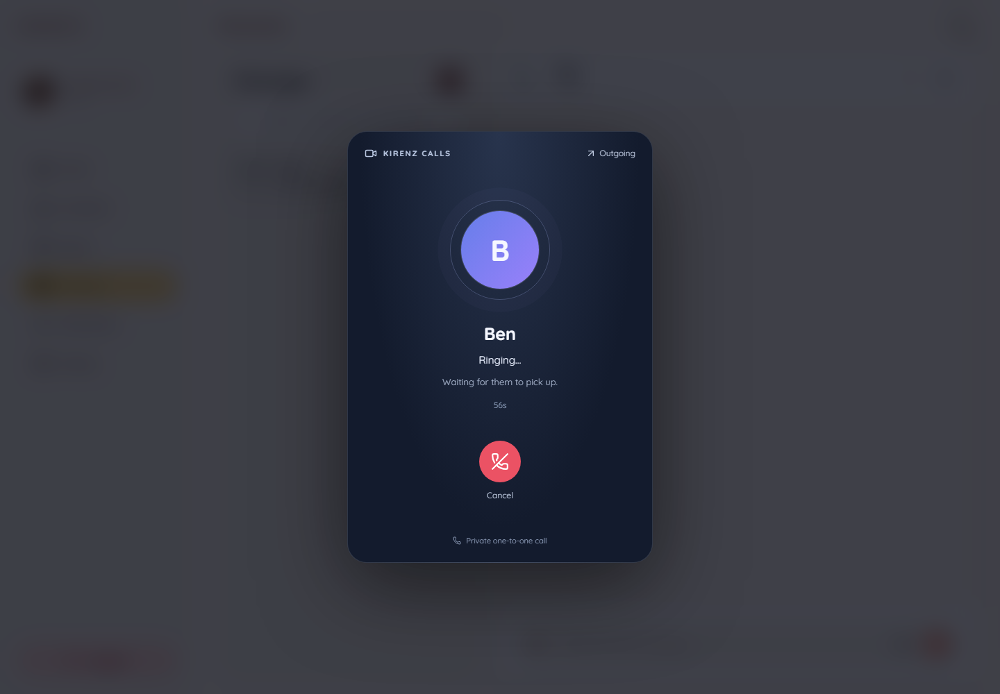
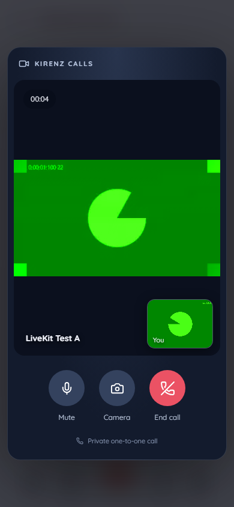

# One-to-one video calls

Video calls belong to existing active DIRECT conversations. The chat service owns invitations and authorization; LiveKit Cloud carries camera and microphone tracks. Incoming calls appear across the signed-in web app, including outside the Chat page.

## Configure and run

1. Create a LiveKit Cloud project and copy the project WebSocket URL, API key and API secret into the root `.env`. The placeholders are also documented in [`.env.livekit.example`](../.env.livekit.example).
2. Set `LIVEKIT_URL=wss://<project>.livekit.cloud`, `LIVEKIT_API_KEY` and `LIVEKIT_API_SECRET`. Credentials remain inside the chat service; never add a `VITE_` prefix to them.
3. Run `docker compose --env-file .env up -d --build chat-service api-gateway frontend`. When only credentials change, run `docker compose --env-file .env up -d --no-deps --force-recreate chat-service`.
4. Use two signed-in users in separate browser profiles/devices. Open a direct conversation and press **Start video call**. Use HTTPS outside localhost; browsers require a secure context for camera/microphone.

Missing/placeholder credentials keep ordinary chat operational. Starting a call returns a clear 503 until real credentials are supplied. A backend launched directly needs the same variables in its process environment. The configured TTL is the join-token lifetime, not a limit on call duration.

## Behavior

- A starts: B receives an incoming overlay and ringtone, A hears ringback. If autoplay is blocked, **Enable ringtone** enables sound after a user gesture. Notifications work while the app is open and signed in; closed-browser push calls are outside this implementation.
- B accepts: both use the same random room with separate opaque participant identities. A and B pressing Call simultaneously accepts the existing invitation rather than creating competing rooms.
- Decline, caller cancellation, no answer after 60 seconds, and either user hanging up update both clients and add a system entry to the conversation.
- Camera and microphone are requested on join. Permission/device failure shows a retry message and allows audio-only fallback. Remote audio includes the browser autoplay recovery button. Controls toggle local camera/microphone; a timer and connection/reconnection state are visible.
- A global provider keeps a call alive across app navigation. Reload/close/logout requests hangup with fetch keepalive; a missing participant heartbeat ends abandoned calls after 45 seconds. Remote media disconnect gets a 15-second grace period. Reopening an active call offers **Join call** on this device rather than automatically taking over media from another tab.
- WebSocket signaling uses the authenticated `/user/queue/calls` destination. REST reconciliation and heartbeats run every five seconds to recover missed events. Call revisions prevent old ringing/accepted responses from reopening ended calls. Join tokens live only in component memory and all call responses use `Cache-Control: no-store`.
- Redis locks on both users serialize crossing invitations, busy checks, acceptance, token issuance and hangup. MongoDB stores call state across service restarts. A five-second maintenance job expires invitations, detects abandoned calls and retries media shutdown.
- Hangup first stores ENDED and blocks new tokens, then explicitly revokes both Cloud participants with `revoke_token_ts` and deletes the room. If the provider fails, `mediaClosed=false` truthfully reports pending cleanup and maintenance retries. Keep the backend clock synchronized.

## Endpoints

All endpoints require the app bearer token, and all call-specific actions require membership. Caller/callee and room/identities are derived by the server. Successful REST responses use the standard `{ "success": true, "message": "...", "data": ... }` envelope; `/active` returns `data: null` when there is no call. The `video-access` data contains `serverUrl`, `participantToken`, and `expiresAt`. WebSocket events carry `CallView` directly. All call responses disable caching with `Cache-Control: no-store`.

| Method | Path | Purpose |
| --- | --- | --- |
| POST | `/api/calls` | `{ "conversationId": "..." }` starts or resolves a crossing invitation |
| GET | `/api/calls/active` | Current user's active invitation/call, or null |
| GET | `/api/calls/{id}` | Reconcile call state |
| POST | `/api/calls/{id}/accept` | Callee accepts |
| POST | `/api/calls/{id}/decline` | Callee declines |
| POST | `/api/calls/{id}/video-access` | Accepted member receives serverUrl, participantToken, expiresAt |
| POST | `/api/calls/{id}/heartbeat` | Refresh owning device presence |
| POST | `/api/calls/{id}/end` | Either participant ends the call for both |

## Verification

Backend: `cd chat-service && ./mvnw test`. Frontend: `cd frontend && npm run lint && npm test && npm run build`.

With real Cloud credentials, verify two-way video/audio in two browser profiles, camera/mic toggles, ringtone, accept/decline/cancel, simultaneous calling, busy recipient, missed call timeout, hangup from either side, device denial, reconnect, reload/logout and third-party token rejection. Cloud media cannot be verified using placeholder credentials.

### Cloud verification — 10 November 2026

Verified against the running Docker app at `http://localhost:3000` with real LiveKit Cloud credentials and two isolated Chromium sessions. All app APIs, password authentication, databases, Redis locks, WebSocket signaling and Cloud media connections were real. The accounts and camera/microphone input were temporary test fixtures; physical device quality still needs manual testing.

Passed: incoming invitation outside Chat, acceptance, remote video frames and playing remote audio on both sides, camera off/on visible to the peer, microphone mute/unmute, callee hangup ending both clients, media release, Cloud cleanup, new-token denial after termination, old-token rejoin rejection, decline, caller cancellation and concurrent invitations resolving to one accepted call. The connected desktop/mobile screenshots and structured test result are in `.verification/screenshots/cloud-connected-*.png` and `.verification/livekit-cloud-results.json` (ignored local artifacts).

The Cloud test exposed a lock timeout: initial room creation could take longer than the previous three-second participant-lock wait. The wait is now fifteen seconds, covering the bounded provider operations, and a concurrent-access regression test verifies both participants can obtain tokens when room creation exceeds three seconds. All 23 backend tests pass after the fix. The updated chat-service image is running.

To test manually: open Chrome and an Incognito window (or two separate browser profiles), sign in as two different users, select their direct conversation, and press the video icon. Accept in the second session and allow camera/microphone permissions. Try muting, toggling the camera and ending from either side. Keep both sessions open; calling notifications require the recipient to be signed in with the app open. Use headphones or two separate devices to avoid feedback. Real phones accessing a LAN IP require HTTPS rather than plain HTTP for device permissions.

### Pull request validation — 11 November 2026

REST responses were aligned with the project's `ApiResponse` envelope before opening the PR. Validation passed: 24 backend tests, frontend TypeScript lint, 24 frontend tests and the production build. The controller and frontend service tests cover extracting access tokens and preserving `data: null` for an inactive call.

The Docker build and the full two-browser Cloud flow were rerun successfully against that final envelope: invitations outside Chat, two-way video/audio, device controls, decline/cancel, simultaneous invitations, hangup, room cleanup and old-token rejection. Temporary fixtures were removed afterward.

| Outgoing call | Connected Cloud call on mobile (synthetic camera) |
| --- | --- |
|  |  |

SDK references: [LiveKitRoom](https://docs.livekit.io/reference/components/react/component/livekitroom/), [token grants and Cloud revocation](https://docs.livekit.io/frontends/reference/tokens-grants/), [server SDK 0.16.0](https://github.com/livekit/server-sdk-kotlin/tree/v0.16.0).
